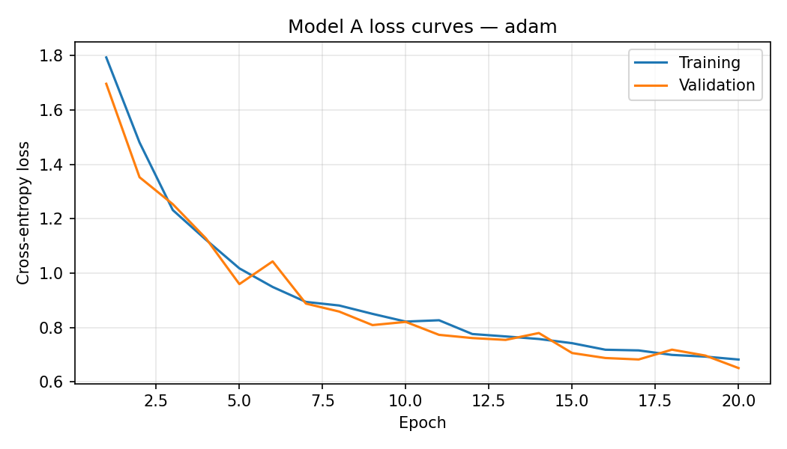
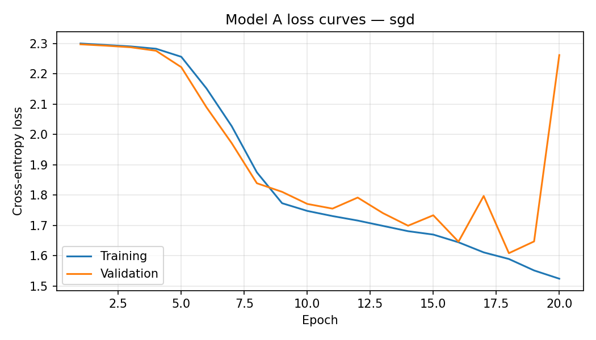
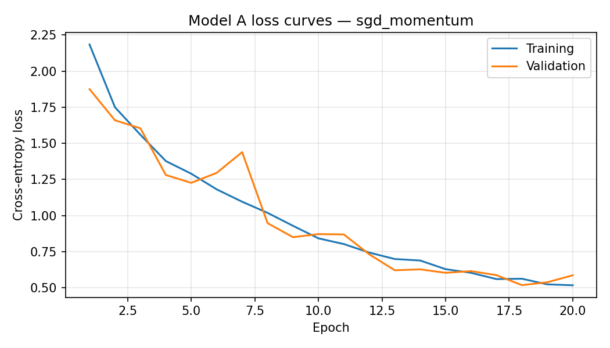

# Model A: EuroSAT experiment report

- Dataset SHA-256: `548a976e7d3f714d69f2a93f1abaf6261494537faa33af10f762ad7614644dd1`
- Classes: AnnualCrop, Forest, HerbaceousVegetation, Highway, Industrial, Pasture, PermanentCrop, Residential, River, SeaLake
- Epochs per optimizer: 20
- Batch size: 64
- Seed: 42
- Device: cpu
- Hardware: Intel64 Family 6 Model 183 Stepping 1, GenuineIntel (Windows-11-10.0.26200-SP0)
- Python: 3.13.2
- PyTorch: 2.14.1+cpu

## Architecture and parameter count

Input is a 3×64×64 RGB image. Each standard convolution uses a 3×3 kernel, stride 1, padding 1, and a bias; each is followed by ReLU and 2×2 max pooling with stride 2. The channel/spatial progression is `3×64×64 → 16×32×32 → 32×16×16 → 64×8×8`. Adaptive average pooling produces 64 features, followed by fully connected layers `64 → 32 → 10`.

| Layer | Parameter calculation | Parameters |
| --- | --- | ---: |
| Conv2d 3→16 | 16 × (3 × 3 × 3 + 1) | 448 |
| Conv2d 16→32 | 32 × (16 × 3 × 3 + 1) | 4,640 |
| Conv2d 32→64 | 64 × (32 × 3 × 3 + 1) | 18,496 |
| Adaptive average pooling | No learned weights | 0 |
| Linear 64→32 | 64 × 32 + 32 | 2,080 |
| Linear 32→10 | 32 × 10 + 10 | 330 |
| **Total** |  | **25,994** |

At FP32, the weights-only estimate is **101.54 KiB** (parameters × 4 bytes ÷ 1,024). This excludes checkpoint metadata; actual checkpoint sizes are reported below.

### Activation choice

ReLU computes max(0, x), avoiding the exponential used by sigmoid/tanh and being less prone to saturating gradients. It is supported efficiently by common CPUs, DSPs, and quantized inference kernels. In-place ReLU can reuse activation storage. Max pooling and global average pooling reduce the spatial activation footprint and the classifier input size.

## Optimizer comparison and held-out test results

All optimizers use cross-entropy, no weight decay, and no learning-rate scheduler. The checkpoint with minimum validation loss is evaluated on the held-out test set.

| Optimizer | Learning rate | Momentum | Accuracy | Macro precision | Macro recall | Parameters | FP32 weights (KiB) | Checkpoint (KiB) | Mean epoch (s) | Best epoch |
| --- | ---: | ---: | ---: | ---: | ---: | ---: | ---: | ---: | ---: | ---: |
| adam | 0.001 | — | 0.7580 | 0.7532 | 0.7491 | 25,994 | 101.54 | 105.55 | 93.60 | 20 |
| sgd | 0.01 | — | 0.3837 | 0.4214 | 0.3886 | 25,994 | 101.54 | 105.55 | 58.32 | 18 |
| sgd_momentum | 0.01 | 0.9 | 0.8168 | 0.8106 | 0.8089 | 25,994 | 101.54 | 105.61 | 31.11 | 18 |

### Optimizer rationale and confusion matrices

#### adam

Primary optimizer: adaptive per-parameter updates are a practical baseline for this compact CNN without a learning-rate schedule.

Loss history: [`adam/training_history.csv`](./adam/training_history.csv)  
Detailed metrics JSON: [`adam/test_metrics.json`](./adam/test_metrics.json)

Confusion matrix (rows = true class, columns = predicted class):

| True / Predicted | AnnualCrop | Forest | HerbaceousVegetation | Highway | Industrial | Pasture | PermanentCrop | Residential | River | SeaLake |
|  --- | --- | --- | --- | --- | --- | --- | --- | --- | --- | --- |
| AnnualCrop | 377 | 2 | 9 | 4 | 0 | 11 | 14 | 0 | 24 | 9 |
| Forest | 0 | 413 | 5 | 2 | 0 | 20 | 0 | 0 | 3 | 7 |
| HerbaceousVegetation | 3 | 3 | 293 | 37 | 7 | 10 | 69 | 10 | 13 | 5 |
| Highway | 16 | 1 | 21 | 199 | 13 | 7 | 57 | 15 | 46 | 0 |
| Industrial | 0 | 0 | 0 | 15 | 337 | 0 | 6 | 17 | 0 | 0 |
| Pasture | 3 | 14 | 22 | 12 | 0 | 221 | 8 | 0 | 19 | 1 |
| PermanentCrop | 25 | 0 | 73 | 48 | 6 | 5 | 218 | 0 | 0 | 0 |
| Residential | 0 | 0 | 4 | 12 | 14 | 0 | 2 | 418 | 0 | 0 |
| River | 16 | 17 | 11 | 113 | 0 | 13 | 1 | 0 | 198 | 6 |
| SeaLake | 3 | 32 | 9 | 0 | 0 | 3 | 0 | 0 | 7 | 396 |

Per-class precision and recall:

| Class | Precision | Recall | Support |
| --- | ---: | ---: | ---: |
| AnnualCrop | 0.8510 | 0.8378 | 450 |
| Forest | 0.8568 | 0.9178 | 450 |
| HerbaceousVegetation | 0.6555 | 0.6511 | 450 |
| Highway | 0.4502 | 0.5307 | 375 |
| Industrial | 0.8939 | 0.8987 | 375 |
| Pasture | 0.7621 | 0.7367 | 300 |
| PermanentCrop | 0.5813 | 0.5813 | 375 |
| Residential | 0.9087 | 0.9289 | 450 |
| River | 0.6387 | 0.5280 | 375 |
| SeaLake | 0.9340 | 0.8800 | 450 |

#### sgd

Plain-SGD reference using the same fixed learning rate throughout training.

Loss history: [`sgd/training_history.csv`](./sgd/training_history.csv)  
Detailed metrics JSON: [`sgd/test_metrics.json`](./sgd/test_metrics.json)

Confusion matrix (rows = true class, columns = predicted class):

| True / Predicted | AnnualCrop | Forest | HerbaceousVegetation | Highway | Industrial | Pasture | PermanentCrop | Residential | River | SeaLake |
|  --- | --- | --- | --- | --- | --- | --- | --- | --- | --- | --- |
| AnnualCrop | 314 | 7 | 0 | 5 | 57 | 15 | 16 | 12 | 24 | 0 |
| Forest | 0 | 396 | 0 | 0 | 0 | 50 | 0 | 0 | 4 | 0 |
| HerbaceousVegetation | 46 | 1 | 19 | 0 | 155 | 30 | 81 | 94 | 23 | 1 |
| Highway | 60 | 1 | 0 | 12 | 87 | 47 | 22 | 83 | 63 | 0 |
| Industrial | 4 | 0 | 0 | 0 | 321 | 0 | 37 | 13 | 0 | 0 |
| Pasture | 0 | 33 | 0 | 1 | 16 | 185 | 0 | 32 | 31 | 2 |
| PermanentCrop | 134 | 0 | 2 | 0 | 79 | 10 | 85 | 41 | 24 | 0 |
| Residential | 15 | 0 | 1 | 0 | 211 | 14 | 69 | 127 | 13 | 0 |
| River | 13 | 26 | 0 | 13 | 30 | 140 | 0 | 60 | 93 | 0 |
| SeaLake | 0 | 297 | 0 | 0 | 16 | 106 | 0 | 23 | 6 | 2 |

Per-class precision and recall:

| Class | Precision | Recall | Support |
| --- | ---: | ---: | ---: |
| AnnualCrop | 0.5358 | 0.6978 | 450 |
| Forest | 0.5204 | 0.8800 | 450 |
| HerbaceousVegetation | 0.8636 | 0.0422 | 450 |
| Highway | 0.3871 | 0.0320 | 375 |
| Industrial | 0.3302 | 0.8560 | 375 |
| Pasture | 0.3099 | 0.6167 | 300 |
| PermanentCrop | 0.2742 | 0.2267 | 375 |
| Residential | 0.2619 | 0.2822 | 450 |
| River | 0.3310 | 0.2480 | 375 |
| SeaLake | 0.4000 | 0.0044 | 450 |

#### sgd_momentum

Momentum (0.9) accumulates a smoothed gradient direction. It can accelerate consistent descent and damp mini-batch oscillation; excessive momentum can overshoot, so compare its measured loss curves and test results.

Loss history: [`sgd_momentum/training_history.csv`](./sgd_momentum/training_history.csv)  
Detailed metrics JSON: [`sgd_momentum/test_metrics.json`](./sgd_momentum/test_metrics.json)

Confusion matrix (rows = true class, columns = predicted class):

| True / Predicted | AnnualCrop | Forest | HerbaceousVegetation | Highway | Industrial | Pasture | PermanentCrop | Residential | River | SeaLake |
|  --- | --- | --- | --- | --- | --- | --- | --- | --- | --- | --- |
| AnnualCrop | 411 | 1 | 3 | 3 | 0 | 7 | 12 | 0 | 11 | 2 |
| Forest | 0 | 396 | 5 | 1 | 0 | 28 | 0 | 0 | 1 | 19 |
| HerbaceousVegetation | 3 | 3 | 354 | 12 | 6 | 12 | 49 | 9 | 0 | 2 |
| Highway | 20 | 0 | 24 | 212 | 17 | 7 | 59 | 4 | 32 | 0 |
| Industrial | 0 | 0 | 0 | 10 | 345 | 0 | 8 | 12 | 0 | 0 |
| Pasture | 7 | 5 | 9 | 7 | 0 | 241 | 14 | 1 | 13 | 3 |
| PermanentCrop | 15 | 0 | 45 | 36 | 1 | 13 | 264 | 1 | 0 | 0 |
| Residential | 0 | 0 | 7 | 5 | 12 | 0 | 3 | 423 | 0 | 0 |
| River | 18 | 12 | 6 | 90 | 0 | 6 | 5 | 0 | 236 | 2 |
| SeaLake | 11 | 4 | 2 | 0 | 0 | 1 | 0 | 0 | 6 | 426 |

Per-class precision and recall:

| Class | Precision | Recall | Support |
| --- | ---: | ---: | ---: |
| AnnualCrop | 0.8474 | 0.9133 | 450 |
| Forest | 0.9406 | 0.8800 | 450 |
| HerbaceousVegetation | 0.7780 | 0.7867 | 450 |
| Highway | 0.5638 | 0.5653 | 375 |
| Industrial | 0.9055 | 0.9200 | 375 |
| Pasture | 0.7651 | 0.8033 | 300 |
| PermanentCrop | 0.6377 | 0.7040 | 375 |
| Residential | 0.9400 | 0.9400 | 450 |
| River | 0.7893 | 0.6293 | 375 |
| SeaLake | 0.9383 | 0.9467 | 450 |
