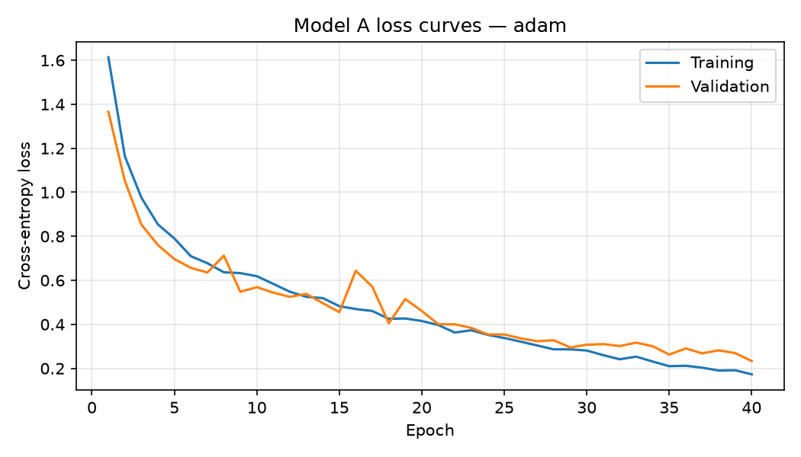
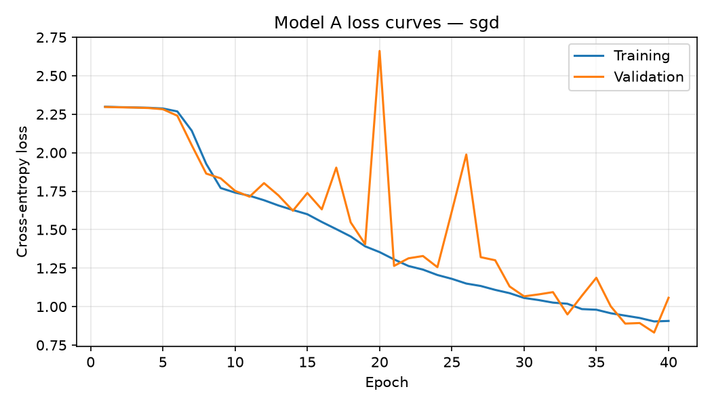
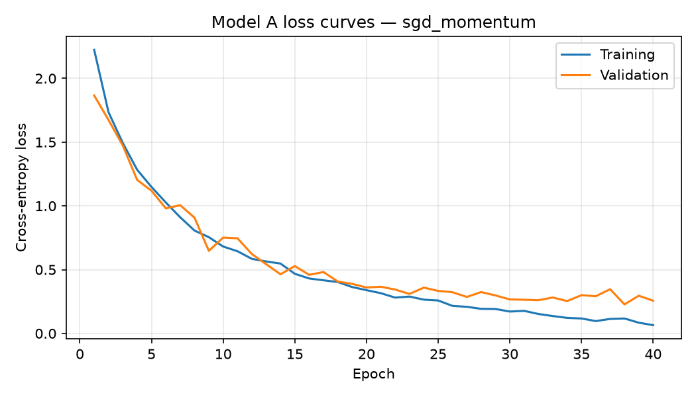

# Model A: EuroSAT experiment report

- Dataset SHA-256: `548a976e7d3f714d69f2a93f1abaf6261494537faa33af10f762ad7614644dd1`
- Classes: AnnualCrop, Forest, HerbaceousVegetation, Highway, Industrial, Pasture, PermanentCrop, Residential, River, SeaLake
- Epochs per optimizer: 40
- Batch size: 64
- Seed: 42
- Device: cuda:0
- Hardware: x86_64 (Linux-7.0.0-38-generic-x86_64-with-glibc2.39)
- Python: 3.12.3
- PyTorch: 2.4.1+cu121

## Architecture and parameter count

Input is a 3×64×64 RGB image. Each standard convolution uses a 3×3 kernel, stride 1, padding 1, and a bias; each is followed by ReLU and 2×2 max pooling with stride 2. The channel/spatial progression is `3×64×64 → 32×32×32 → 64×16×16 → 96×8×8 → 112×4×4`. Adaptive average pooling produces 112 features, followed by fully connected layers `112 → 192 → 10`.

| Layer | Parameter calculation | Parameters |
| --- | --- | ---: |
| Conv2d 3→32 | 32 × (3 × 3 × 3 + 1) | 896 |
| Conv2d 32→64 | 64 × (32 × 3 × 3 + 1) | 18,496 |
| Conv2d 64→96 | 96 × (64 × 3 × 3 + 1) | 55,392 |
| Conv2d 96→112 | 112 × (96 × 3 × 3 + 1) | 96,880 |
| Adaptive average pooling | No learned weights | 0 |
| Linear 112→192 | 112 × 192 + 192 | 21,696 |
| Linear 192→10 | 192 × 10 + 10 | 1,930 |
| **Total** |  | **195,290** |

At FP32, the weights-only estimate is **762.85 KiB** (parameters × 4 bytes ÷ 1,024). This excludes checkpoint metadata; actual checkpoint sizes are reported below.

### Activation choice

ReLU computes max(0, x), avoiding the exponential used by sigmoid/tanh and being less prone to saturating gradients. It is supported efficiently by common CPUs, DSPs, and quantized inference kernels. In-place ReLU can reuse activation storage. Pooling after every convolution halves width and height before the next block, limiting the activation memory used by the wider layers; global average pooling also avoids a large flatten-and-dense layer.

## Optimizer comparison and held-out test results

All optimizers use cross-entropy, no weight decay, and no learning-rate scheduler. The checkpoint with minimum validation loss is evaluated on the held-out test set.

| Optimizer | Learning rate | Momentum | Accuracy | Macro precision | Macro recall | Parameters | FP32 weights (KiB) | Checkpoint (KiB) | Mean epoch (s) | Best epoch |
| --- | ---: | ---: | ---: | ---: | ---: | ---: | ---: | ---: | ---: | ---: |
| adam | 0.001 | — | 0.9242 | 0.9241 | 0.9204 | 195,290 | 762.85 | 767.03 | 5.98 | 40 |
| sgd | 0.01 | — | 0.6926 | 0.6895 | 0.6828 | 195,290 | 762.85 | 767.03 | 6.48 | 39 |
| sgd_momentum | 0.01 | 0.9 | 0.9294 | 0.9267 | 0.9276 | 195,290 | 762.85 | 767.03 | 6.12 | 38 |

### Optimizer rationale and confusion matrices

#### adam

Primary optimizer: adaptive per-parameter updates are a practical baseline for this resource-constrained CNN without a learning-rate schedule.

Loss history: [`adam/training_history.csv`](./adam/training_history.csv)  
Detailed metrics JSON: [`adam/test_metrics.json`](./adam/test_metrics.json)

Confusion matrix (rows = true class, columns = predicted class):

| True / Predicted | AnnualCrop | Forest | HerbaceousVegetation | Highway | Industrial | Pasture | PermanentCrop | Residential | River | SeaLake |
|  --- | --- | --- | --- | --- | --- | --- | --- | --- | --- | --- |
| AnnualCrop | 428 | 1 | 5 | 2 | 0 | 7 | 2 | 0 | 4 | 1 |
| Forest | 1 | 430 | 5 | 0 | 0 | 9 | 0 | 0 | 1 | 4 |
| HerbaceousVegetation | 0 | 2 | 411 | 8 | 6 | 8 | 4 | 9 | 2 | 0 |
| Highway | 2 | 0 | 5 | 337 | 14 | 3 | 3 | 2 | 9 | 0 |
| Industrial | 0 | 0 | 1 | 6 | 354 | 0 | 1 | 13 | 0 | 0 |
| Pasture | 7 | 0 | 7 | 6 | 0 | 271 | 0 | 1 | 7 | 1 |
| PermanentCrop | 14 | 0 | 46 | 15 | 2 | 6 | 287 | 2 | 3 | 0 |
| Residential | 0 | 0 | 1 | 0 | 4 | 0 | 0 | 445 | 0 | 0 |
| River | 14 | 2 | 0 | 16 | 0 | 0 | 2 | 0 | 338 | 3 |
| SeaLake | 3 | 1 | 0 | 0 | 0 | 2 | 0 | 0 | 2 | 442 |

Per-class precision and recall:

| Class | Precision | Recall | Support |
| --- | ---: | ---: | ---: |
| AnnualCrop | 0.9126 | 0.9511 | 450 |
| Forest | 0.9862 | 0.9556 | 450 |
| HerbaceousVegetation | 0.8545 | 0.9133 | 450 |
| Highway | 0.8641 | 0.8987 | 375 |
| Industrial | 0.9316 | 0.9440 | 375 |
| Pasture | 0.8856 | 0.9033 | 300 |
| PermanentCrop | 0.9599 | 0.7653 | 375 |
| Residential | 0.9428 | 0.9889 | 450 |
| River | 0.9235 | 0.9013 | 375 |
| SeaLake | 0.9800 | 0.9822 | 450 |

#### sgd

Plain-SGD reference using the same fixed learning rate throughout training.

Loss history: [`sgd/training_history.csv`](./sgd/training_history.csv)  
Detailed metrics JSON: [`sgd/test_metrics.json`](./sgd/test_metrics.json)

Confusion matrix (rows = true class, columns = predicted class):

| True / Predicted | AnnualCrop | Forest | HerbaceousVegetation | Highway | Industrial | Pasture | PermanentCrop | Residential | River | SeaLake |
|  --- | --- | --- | --- | --- | --- | --- | --- | --- | --- | --- |
| AnnualCrop | 337 | 5 | 17 | 0 | 0 | 24 | 22 | 5 | 34 | 6 |
| Forest | 0 | 395 | 5 | 0 | 0 | 34 | 0 | 1 | 3 | 12 |
| HerbaceousVegetation | 1 | 3 | 270 | 13 | 4 | 10 | 46 | 89 | 11 | 3 |
| Highway | 25 | 0 | 14 | 124 | 11 | 11 | 46 | 70 | 74 | 0 |
| Industrial | 0 | 0 | 1 | 1 | 339 | 0 | 2 | 32 | 0 | 0 |
| Pasture | 1 | 18 | 30 | 2 | 0 | 198 | 7 | 9 | 30 | 5 |
| PermanentCrop | 22 | 0 | 91 | 31 | 5 | 9 | 160 | 51 | 6 | 0 |
| Residential | 0 | 0 | 5 | 0 | 11 | 0 | 2 | 432 | 0 | 0 |
| River | 17 | 10 | 8 | 63 | 0 | 34 | 3 | 14 | 220 | 6 |
| SeaLake | 0 | 76 | 18 | 1 | 0 | 4 | 0 | 6 | 15 | 330 |

Per-class precision and recall:

| Class | Precision | Recall | Support |
| --- | ---: | ---: | ---: |
| AnnualCrop | 0.8362 | 0.7489 | 450 |
| Forest | 0.7791 | 0.8778 | 450 |
| HerbaceousVegetation | 0.5882 | 0.6000 | 450 |
| Highway | 0.5277 | 0.3307 | 375 |
| Industrial | 0.9162 | 0.9040 | 375 |
| Pasture | 0.6111 | 0.6600 | 300 |
| PermanentCrop | 0.5556 | 0.4267 | 375 |
| Residential | 0.6093 | 0.9600 | 450 |
| River | 0.5598 | 0.5867 | 375 |
| SeaLake | 0.9116 | 0.7333 | 450 |

#### sgd_momentum

Momentum (0.9) accumulates a smoothed gradient direction. It can accelerate consistent descent and damp mini-batch oscillation; excessive momentum can overshoot, so compare its measured loss curves and test results.

Loss history: [`sgd_momentum/training_history.csv`](./sgd_momentum/training_history.csv)  
Detailed metrics JSON: [`sgd_momentum/test_metrics.json`](./sgd_momentum/test_metrics.json)

Confusion matrix (rows = true class, columns = predicted class):

| True / Predicted | AnnualCrop | Forest | HerbaceousVegetation | Highway | Industrial | Pasture | PermanentCrop | Residential | River | SeaLake |
|  --- | --- | --- | --- | --- | --- | --- | --- | --- | --- | --- |
| AnnualCrop | 412 | 1 | 1 | 4 | 0 | 7 | 7 | 0 | 13 | 5 |
| Forest | 1 | 442 | 2 | 0 | 0 | 3 | 0 | 2 | 0 | 0 |
| HerbaceousVegetation | 1 | 3 | 386 | 9 | 6 | 6 | 27 | 5 | 5 | 2 |
| Highway | 1 | 0 | 2 | 337 | 11 | 3 | 7 | 2 | 12 | 0 |
| Industrial | 0 | 0 | 0 | 4 | 363 | 0 | 1 | 7 | 0 | 0 |
| Pasture | 2 | 9 | 6 | 2 | 0 | 269 | 5 | 0 | 7 | 0 |
| PermanentCrop | 9 | 0 | 11 | 11 | 3 | 4 | 331 | 4 | 2 | 0 |
| Residential | 0 | 0 | 0 | 1 | 15 | 0 | 0 | 434 | 0 | 0 |
| River | 8 | 2 | 1 | 14 | 0 | 1 | 0 | 0 | 347 | 2 |
| SeaLake | 1 | 1 | 1 | 0 | 0 | 0 | 0 | 0 | 4 | 443 |

Per-class precision and recall:

| Class | Precision | Recall | Support |
| --- | ---: | ---: | ---: |
| AnnualCrop | 0.9471 | 0.9156 | 450 |
| Forest | 0.9651 | 0.9822 | 450 |
| HerbaceousVegetation | 0.9415 | 0.8578 | 450 |
| Highway | 0.8822 | 0.8987 | 375 |
| Industrial | 0.9121 | 0.9680 | 375 |
| Pasture | 0.9181 | 0.8967 | 300 |
| PermanentCrop | 0.8757 | 0.8827 | 375 |
| Residential | 0.9559 | 0.9644 | 450 |
| River | 0.8897 | 0.9253 | 375 |
| SeaLake | 0.9801 | 0.9844 | 450 |
