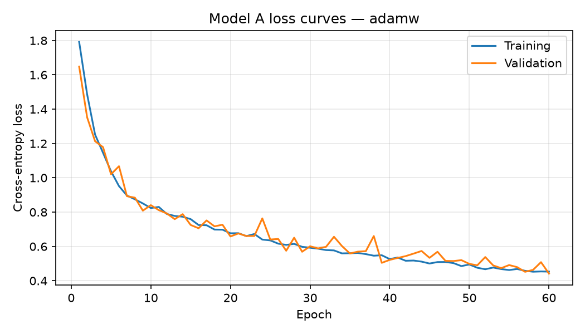
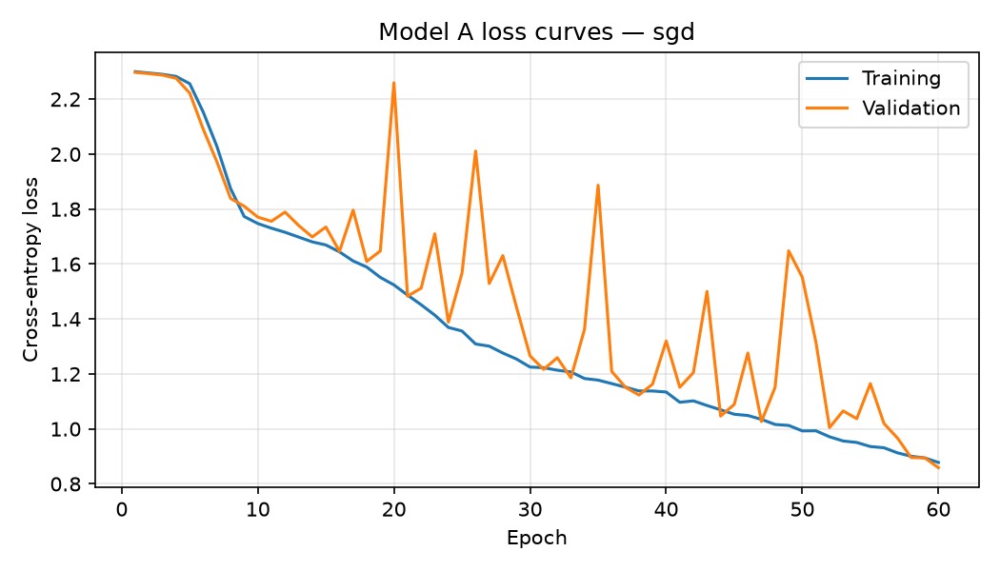
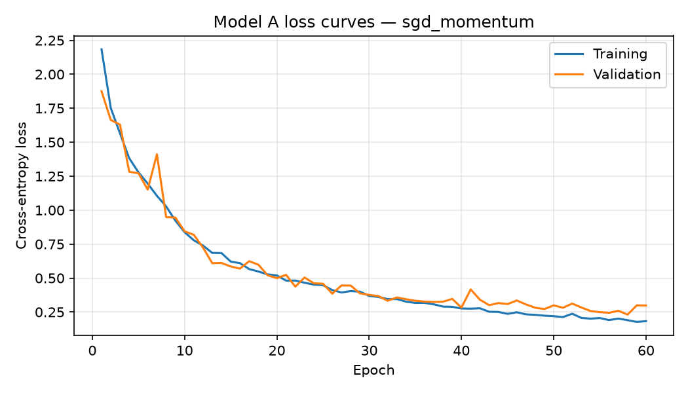

# Model A: EuroSAT experiment report

- Dataset SHA-256: `548a976e7d3f714d69f2a93f1abaf6261494537faa33af10f762ad7614644dd1`
- Classes: AnnualCrop, Forest, HerbaceousVegetation, Highway, Industrial, Pasture, PermanentCrop, Residential, River, SeaLake
- Epochs per optimizer: 60
- Batch size: 64
- Seed: 42
- Device: cuda
- Hardware: x86_64 (Linux-7.0.0-38-generic-x86_64-with-glibc2.39)
- Python: 3.12.3
- PyTorch: 2.4.1+cu121

## Architecture and parameter count

Input is a 3×64×64 RGB image. Each standard convolution uses a 3×3 kernel, stride 1, padding 1, and a bias; each is followed by ReLU and 2×2 max pooling with stride 2. The channel/spatial progression is `3×64×64 → 16×32×32 → 32×16×16 → 64×8×8`. Adaptive average pooling produces 64 features, followed by fully connected layers `64 → 32 → 10`.

| Layer | Parameter calculation | Parameters |
| --- | --- | ---: |
| Conv2d 3→16 | 16 × (3 × 3 × 3 + 1) | 448 |
| Conv2d 16→32 | 32 × (16 × 3 × 3 + 1) | 4,640 |
| Conv2d 32→64 | 64 × (32 × 3 × 3 + 1) | 18,496 |
| Adaptive average pooling | No learned weights | 0 |
| Linear 64→32 | 64 × 32 + 32 | 2,080 |
| Linear 32→10 | 32 × 10 + 10 | 330 |
| **Total** |  | **25,994** |

At FP32, the weights-only estimate is **101.54 KiB** (parameters × 4 bytes ÷ 1,024). This excludes checkpoint metadata; actual checkpoint sizes are reported below.

### Activation choice

ReLU computes max(0, x), avoiding the exponential used by sigmoid/tanh and being less prone to saturating gradients. It is supported efficiently by common CPUs, DSPs, and quantized inference kernels. In-place ReLU can reuse activation storage. Max pooling and global average pooling reduce the spatial activation footprint and the classifier input size.

## Optimizer comparison and held-out test results

All optimizers use cross-entropy and no learning-rate scheduler. AdamW uses decoupled weight decay of 0.0001; both SGD baselines have zero weight decay. The checkpoint with minimum validation loss is evaluated on the held-out test set.

| Optimizer | Learning rate | Momentum | Accuracy | Macro precision | Macro recall | Parameters | FP32 weights (KiB) | Checkpoint (KiB) | Mean epoch (s) | Best epoch |
| --- | ---: | ---: | ---: | ---: | ---: | ---: | ---: | ---: | ---: | ---: |
| adamw | 0.001 | — | 0.8541 | 0.8479 | 0.8500 | 25,994 | 101.54 | 105.16 | 7.96 | 60 |
| sgd | 0.01 | — | 0.6857 | 0.6888 | 0.6789 | 25,994 | 101.54 | 105.16 | 5.42 | 60 |
| sgd_momentum | 0.01 | 0.9 | 0.9183 | 0.9157 | 0.9160 | 25,994 | 101.54 | 105.22 | 4.94 | 58 |

### Optimizer rationale and confusion matrices

#### adamw

Primary optimizer: decoupled weight decay (0.0001) and adaptive per-parameter updates, using the historical Model A Adam learning rate for a new 60-epoch run.

Loss history: [`adamw/training_history.csv`](./adamw/training_history.csv)  
Detailed metrics JSON: [`adamw/test_metrics.json`](./adamw/test_metrics.json)

Confusion matrix (rows = true class, columns = predicted class):

| True / Predicted | AnnualCrop | Forest | HerbaceousVegetation | Highway | Industrial | Pasture | PermanentCrop | Residential | River | SeaLake |
|  --- | --- | --- | --- | --- | --- | --- | --- | --- | --- | --- |
| AnnualCrop | 381 | 2 | 7 | 3 | 0 | 10 | 17 | 0 | 16 | 14 |
| Forest | 0 | 432 | 6 | 0 | 0 | 8 | 1 | 0 | 1 | 2 |
| HerbaceousVegetation | 2 | 4 | 345 | 7 | 5 | 11 | 46 | 11 | 15 | 4 |
| Highway | 10 | 2 | 6 | 210 | 15 | 13 | 35 | 9 | 74 | 1 |
| Industrial | 0 | 0 | 2 | 11 | 343 | 0 | 1 | 17 | 1 | 0 |
| Pasture | 2 | 4 | 6 | 3 | 0 | 266 | 9 | 0 | 10 | 0 |
| PermanentCrop | 13 | 0 | 18 | 20 | 4 | 13 | 299 | 1 | 7 | 0 |
| Residential | 0 | 0 | 1 | 6 | 11 | 0 | 0 | 432 | 0 | 0 |
| River | 14 | 8 | 0 | 20 | 1 | 14 | 3 | 0 | 314 | 1 |
| SeaLake | 1 | 4 | 2 | 0 | 0 | 2 | 0 | 0 | 4 | 437 |

Per-class precision and recall:

| Class | Precision | Recall | Support |
| --- | ---: | ---: | ---: |
| AnnualCrop | 0.9007 | 0.8467 | 450 |
| Forest | 0.9474 | 0.9600 | 450 |
| HerbaceousVegetation | 0.8779 | 0.7667 | 450 |
| Highway | 0.7500 | 0.5600 | 375 |
| Industrial | 0.9050 | 0.9147 | 375 |
| Pasture | 0.7893 | 0.8867 | 300 |
| PermanentCrop | 0.7275 | 0.7973 | 375 |
| Residential | 0.9191 | 0.9600 | 450 |
| River | 0.7104 | 0.8373 | 375 |
| SeaLake | 0.9521 | 0.9711 | 450 |

#### sgd

Plain-SGD reference using the same fixed learning rate throughout training.

Loss history: [`sgd/training_history.csv`](./sgd/training_history.csv)  
Detailed metrics JSON: [`sgd/test_metrics.json`](./sgd/test_metrics.json)

Confusion matrix (rows = true class, columns = predicted class):

| True / Predicted | AnnualCrop | Forest | HerbaceousVegetation | Highway | Industrial | Pasture | PermanentCrop | Residential | River | SeaLake |
|  --- | --- | --- | --- | --- | --- | --- | --- | --- | --- | --- |
| AnnualCrop | 303 | 5 | 22 | 0 | 0 | 25 | 48 | 4 | 40 | 3 |
| Forest | 0 | 382 | 5 | 0 | 0 | 38 | 0 | 0 | 14 | 11 |
| HerbaceousVegetation | 0 | 0 | 280 | 12 | 3 | 9 | 47 | 57 | 36 | 6 |
| Highway | 19 | 0 | 12 | 59 | 17 | 9 | 74 | 58 | 127 | 0 |
| Industrial | 1 | 0 | 0 | 0 | 313 | 0 | 5 | 56 | 0 | 0 |
| Pasture | 1 | 10 | 25 | 1 | 0 | 210 | 4 | 2 | 47 | 0 |
| PermanentCrop | 11 | 0 | 84 | 17 | 8 | 11 | 207 | 24 | 13 | 0 |
| Residential | 0 | 0 | 13 | 5 | 11 | 0 | 3 | 410 | 8 | 0 |
| River | 16 | 6 | 4 | 26 | 0 | 24 | 3 | 8 | 287 | 1 |
| SeaLake | 0 | 68 | 13 | 0 | 0 | 18 | 0 | 4 | 21 | 326 |

Per-class precision and recall:

| Class | Precision | Recall | Support |
| --- | ---: | ---: | ---: |
| AnnualCrop | 0.8632 | 0.6733 | 450 |
| Forest | 0.8110 | 0.8489 | 450 |
| HerbaceousVegetation | 0.6114 | 0.6222 | 450 |
| Highway | 0.4917 | 0.1573 | 375 |
| Industrial | 0.8892 | 0.8347 | 375 |
| Pasture | 0.6105 | 0.7000 | 300 |
| PermanentCrop | 0.5294 | 0.5520 | 375 |
| Residential | 0.6581 | 0.9111 | 450 |
| River | 0.4840 | 0.7653 | 375 |
| SeaLake | 0.9395 | 0.7244 | 450 |

#### sgd_momentum

Momentum (0.9) accumulates a smoothed gradient direction. It can accelerate consistent descent and damp mini-batch oscillation; excessive momentum can overshoot, so compare its measured loss curves and test results.

Loss history: [`sgd_momentum/training_history.csv`](./sgd_momentum/training_history.csv)  
Detailed metrics JSON: [`sgd_momentum/test_metrics.json`](./sgd_momentum/test_metrics.json)

Confusion matrix (rows = true class, columns = predicted class):

| True / Predicted | AnnualCrop | Forest | HerbaceousVegetation | Highway | Industrial | Pasture | PermanentCrop | Residential | River | SeaLake |
|  --- | --- | --- | --- | --- | --- | --- | --- | --- | --- | --- |
| AnnualCrop | 430 | 0 | 2 | 2 | 0 | 6 | 3 | 0 | 6 | 1 |
| Forest | 1 | 415 | 6 | 0 | 0 | 25 | 0 | 0 | 1 | 2 |
| HerbaceousVegetation | 0 | 2 | 405 | 2 | 4 | 9 | 18 | 4 | 5 | 1 |
| Highway | 6 | 0 | 8 | 324 | 14 | 2 | 7 | 2 | 12 | 0 |
| Industrial | 0 | 0 | 1 | 6 | 356 | 0 | 2 | 10 | 0 | 0 |
| Pasture | 5 | 0 | 5 | 5 | 0 | 280 | 3 | 0 | 2 | 0 |
| PermanentCrop | 18 | 0 | 26 | 5 | 1 | 13 | 308 | 1 | 3 | 0 |
| Residential | 0 | 0 | 6 | 0 | 10 | 0 | 1 | 433 | 0 | 0 |
| River | 20 | 1 | 3 | 19 | 0 | 2 | 3 | 0 | 326 | 1 |
| SeaLake | 3 | 1 | 0 | 0 | 0 | 0 | 0 | 0 | 4 | 442 |

Per-class precision and recall:

| Class | Precision | Recall | Support |
| --- | ---: | ---: | ---: |
| AnnualCrop | 0.8903 | 0.9556 | 450 |
| Forest | 0.9905 | 0.9222 | 450 |
| HerbaceousVegetation | 0.8766 | 0.9000 | 450 |
| Highway | 0.8926 | 0.8640 | 375 |
| Industrial | 0.9247 | 0.9493 | 375 |
| Pasture | 0.8309 | 0.9333 | 300 |
| PermanentCrop | 0.8928 | 0.8213 | 375 |
| Residential | 0.9622 | 0.9622 | 450 |
| River | 0.9081 | 0.8693 | 375 |
| SeaLake | 0.9888 | 0.9822 | 450 |
