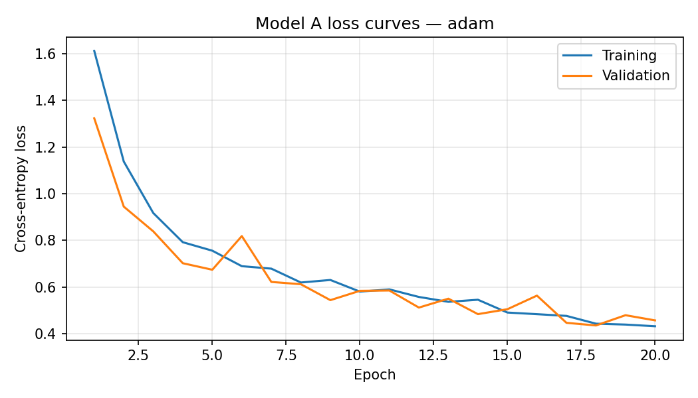
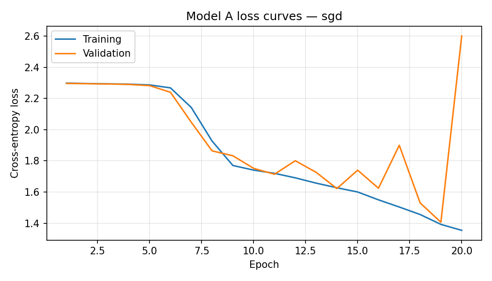
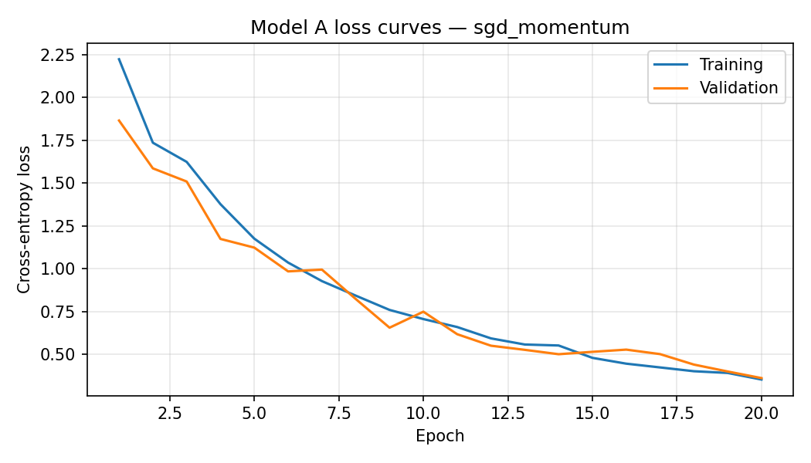

# Model A: EuroSAT experiment report

- Dataset SHA-256: `548a976e7d3f714d69f2a93f1abaf6261494537faa33af10f762ad7614644dd1`
- Classes: AnnualCrop, Forest, HerbaceousVegetation, Highway, Industrial, Pasture, PermanentCrop, Residential, River, SeaLake
- Epochs per optimizer: 20
- Batch size: 64
- Seed: 42
- Device: cuda:0
- Hardware: Intel64 Family 6 Model 183 Stepping 1, GenuineIntel (Windows-11-10.0.26200-SP0)
- Python: 3.13.2
- PyTorch: 2.6.0+cu124

## Architecture and parameter count

Input is a 3×64×64 RGB image. Each standard convolution uses a 3×3 kernel, stride 1, padding 1, and a bias; each is followed by ReLU and 2×2 max pooling with stride 2. The channel/spatial progression is `3×64×64 → 32×32×32 → 64×16×16 → 96×8×8 → 112×4×4`. Adaptive average pooling produces 112 features, followed by fully connected layers `112 → 192 → 10`.

| Layer | Parameter calculation | Parameters |
| --- | --- | ---: |
| Conv2d 3→32 | 32 × (3 × 3 × 3 + 1) | 896 |
| Conv2d 32→64 | 64 × (32 × 3 × 3 + 1) | 18,496 |
| Conv2d 64→96 | 96 × (64 × 3 × 3 + 1) | 55,392 |
| Conv2d 96→112 | 112 × (96 × 3 × 3 + 1) | 96,880 |
| Adaptive average pooling | No learned weights | 0 |
| Linear 112→192 | 112 × 192 + 192 | 21,696 |
| Linear 192→10 | 192 × 10 + 10 | 1,930 |
| **Total** |  | **195,290** |

At FP32, the weights-only estimate is **762.85 KiB** (parameters × 4 bytes ÷ 1,024). This excludes checkpoint metadata; actual checkpoint sizes are reported below.

### Activation choice

ReLU computes max(0, x), avoiding the exponential used by sigmoid/tanh and being less prone to saturating gradients. It is supported efficiently by common CPUs, DSPs, and quantized inference kernels. In-place ReLU can reuse activation storage. Pooling after every convolution halves width and height before the next block, limiting the activation memory used by the wider layers; global average pooling also avoids a large flatten-and-dense layer.

## Optimizer comparison and held-out test results

All optimizers use cross-entropy, no weight decay, and no learning-rate scheduler. The checkpoint with minimum validation loss is evaluated on the held-out test set.

| Optimizer | Learning rate | Momentum | Accuracy | Macro precision | Macro recall | Parameters | FP32 weights (KiB) | Checkpoint (KiB) | Mean epoch (s) | Best epoch |
| --- | ---: | ---: | ---: | ---: | ---: | ---: | ---: | ---: | ---: | ---: |
| adam | 0.001 | — | 0.8533 | 0.8490 | 0.8462 | 195,290 | 762.85 | 767.03 | 55.05 | 18 |
| sgd | 0.01 | — | 0.4691 | 0.4851 | 0.4600 | 195,290 | 762.85 | 767.03 | 55.32 | 19 |
| sgd_momentum | 0.01 | 0.9 | 0.8788 | 0.8808 | 0.8722 | 195,290 | 762.85 | 767.03 | 19.39 | 20 |

### Optimizer rationale and confusion matrices

#### adam

Primary optimizer: adaptive per-parameter updates are a practical baseline for this resource-constrained CNN without a learning-rate schedule.

Loss history: [`adam/training_history.csv`](./adam/training_history.csv)  
Detailed metrics JSON: [`adam/test_metrics.json`](./adam/test_metrics.json)

Confusion matrix (rows = true class, columns = predicted class):

| True / Predicted | AnnualCrop | Forest | HerbaceousVegetation | Highway | Industrial | Pasture | PermanentCrop | Residential | River | SeaLake |
|  --- | --- | --- | --- | --- | --- | --- | --- | --- | --- | --- |
| AnnualCrop | 399 | 1 | 5 | 1 | 0 | 10 | 20 | 0 | 11 | 3 |
| Forest | 0 | 424 | 7 | 0 | 0 | 13 | 0 | 0 | 0 | 6 |
| HerbaceousVegetation | 2 | 6 | 391 | 4 | 3 | 12 | 18 | 11 | 2 | 1 |
| Highway | 9 | 1 | 22 | 222 | 12 | 9 | 41 | 22 | 37 | 0 |
| Industrial | 0 | 0 | 4 | 9 | 318 | 0 | 5 | 39 | 0 | 0 |
| Pasture | 5 | 1 | 9 | 3 | 0 | 265 | 10 | 0 | 6 | 1 |
| PermanentCrop | 6 | 0 | 59 | 10 | 3 | 17 | 273 | 3 | 4 | 0 |
| Residential | 0 | 0 | 1 | 1 | 2 | 0 | 0 | 446 | 0 | 0 |
| River | 14 | 10 | 8 | 36 | 0 | 17 | 5 | 0 | 284 | 1 |
| SeaLake | 5 | 4 | 0 | 0 | 0 | 1 | 0 | 0 | 6 | 434 |

Per-class precision and recall:

| Class | Precision | Recall | Support |
| --- | ---: | ---: | ---: |
| AnnualCrop | 0.9068 | 0.8867 | 450 |
| Forest | 0.9485 | 0.9422 | 450 |
| HerbaceousVegetation | 0.7727 | 0.8689 | 450 |
| Highway | 0.7762 | 0.5920 | 375 |
| Industrial | 0.9408 | 0.8480 | 375 |
| Pasture | 0.7703 | 0.8833 | 300 |
| PermanentCrop | 0.7339 | 0.7280 | 375 |
| Residential | 0.8560 | 0.9911 | 450 |
| River | 0.8114 | 0.7573 | 375 |
| SeaLake | 0.9731 | 0.9644 | 450 |

#### sgd

Plain-SGD reference using the same fixed learning rate throughout training.

Loss history: [`sgd/training_history.csv`](./sgd/training_history.csv)  
Detailed metrics JSON: [`sgd/test_metrics.json`](./sgd/test_metrics.json)

Confusion matrix (rows = true class, columns = predicted class):

| True / Predicted | AnnualCrop | Forest | HerbaceousVegetation | Highway | Industrial | Pasture | PermanentCrop | Residential | River | SeaLake |
|  --- | --- | --- | --- | --- | --- | --- | --- | --- | --- | --- |
| AnnualCrop | 387 | 6 | 3 | 5 | 5 | 9 | 0 | 6 | 29 | 0 |
| Forest | 0 | 394 | 3 | 0 | 0 | 50 | 0 | 0 | 3 | 0 |
| HerbaceousVegetation | 164 | 2 | 164 | 8 | 32 | 18 | 5 | 33 | 24 | 0 |
| Highway | 147 | 1 | 5 | 23 | 56 | 17 | 2 | 25 | 99 | 0 |
| Industrial | 8 | 0 | 0 | 0 | 363 | 0 | 3 | 1 | 0 | 0 |
| Pasture | 23 | 19 | 16 | 5 | 0 | 116 | 0 | 6 | 115 | 0 |
| PermanentCrop | 256 | 0 | 29 | 10 | 21 | 3 | 6 | 20 | 30 | 0 |
| Residential | 44 | 0 | 23 | 2 | 192 | 1 | 17 | 153 | 18 | 0 |
| River | 57 | 21 | 4 | 15 | 20 | 84 | 0 | 6 | 168 | 0 |
| SeaLake | 0 | 176 | 13 | 1 | 3 | 66 | 0 | 30 | 35 | 126 |

Per-class precision and recall:

| Class | Precision | Recall | Support |
| --- | ---: | ---: | ---: |
| AnnualCrop | 0.3564 | 0.8600 | 450 |
| Forest | 0.6365 | 0.8756 | 450 |
| HerbaceousVegetation | 0.6308 | 0.3644 | 450 |
| Highway | 0.3333 | 0.0613 | 375 |
| Industrial | 0.5246 | 0.9680 | 375 |
| Pasture | 0.3187 | 0.3867 | 300 |
| PermanentCrop | 0.1818 | 0.0160 | 375 |
| Residential | 0.5464 | 0.3400 | 450 |
| River | 0.3225 | 0.4480 | 375 |
| SeaLake | 1.0000 | 0.2800 | 450 |

#### sgd_momentum

Momentum (0.9) accumulates a smoothed gradient direction. It can accelerate consistent descent and damp mini-batch oscillation; excessive momentum can overshoot, so compare its measured loss curves and test results.

Loss history: [`sgd_momentum/training_history.csv`](./sgd_momentum/training_history.csv)  
Detailed metrics JSON: [`sgd_momentum/test_metrics.json`](./sgd_momentum/test_metrics.json)

Confusion matrix (rows = true class, columns = predicted class):

| True / Predicted | AnnualCrop | Forest | HerbaceousVegetation | Highway | Industrial | Pasture | PermanentCrop | Residential | River | SeaLake |
|  --- | --- | --- | --- | --- | --- | --- | --- | --- | --- | --- |
| AnnualCrop | 430 | 1 | 3 | 0 | 0 | 1 | 3 | 0 | 10 | 2 |
| Forest | 1 | 418 | 7 | 0 | 0 | 12 | 0 | 0 | 1 | 11 |
| HerbaceousVegetation | 1 | 2 | 370 | 1 | 2 | 9 | 52 | 6 | 7 | 0 |
| Highway | 15 | 0 | 15 | 257 | 9 | 2 | 46 | 4 | 27 | 0 |
| Industrial | 0 | 0 | 13 | 3 | 341 | 0 | 7 | 11 | 0 | 0 |
| Pasture | 14 | 2 | 10 | 4 | 0 | 241 | 16 | 1 | 10 | 2 |
| PermanentCrop | 14 | 0 | 23 | 3 | 0 | 4 | 327 | 3 | 1 | 0 |
| Residential | 0 | 0 | 3 | 2 | 10 | 0 | 2 | 433 | 0 | 0 |
| River | 32 | 5 | 1 | 23 | 0 | 1 | 8 | 0 | 303 | 2 |
| SeaLake | 4 | 2 | 3 | 0 | 0 | 0 | 0 | 0 | 2 | 439 |

Per-class precision and recall:

| Class | Precision | Recall | Support |
| --- | ---: | ---: | ---: |
| AnnualCrop | 0.8415 | 0.9556 | 450 |
| Forest | 0.9721 | 0.9289 | 450 |
| HerbaceousVegetation | 0.8259 | 0.8222 | 450 |
| Highway | 0.8771 | 0.6853 | 375 |
| Industrial | 0.9420 | 0.9093 | 375 |
| Pasture | 0.8926 | 0.8033 | 300 |
| PermanentCrop | 0.7093 | 0.8720 | 375 |
| Residential | 0.9454 | 0.9622 | 450 |
| River | 0.8393 | 0.8080 | 375 |
| SeaLake | 0.9627 | 0.9756 | 450 |
