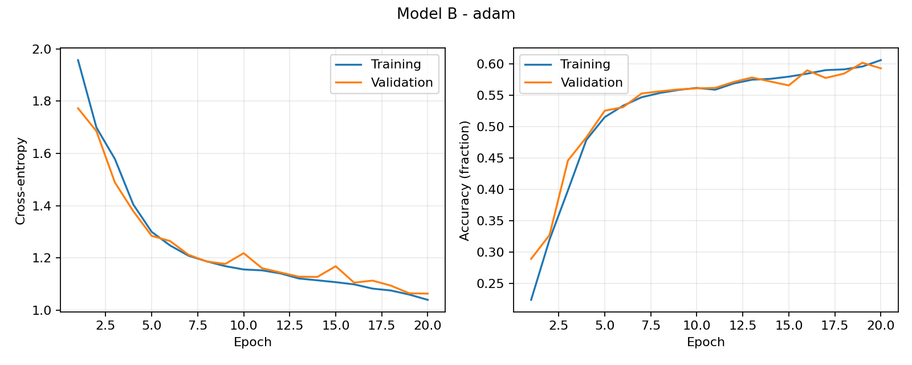
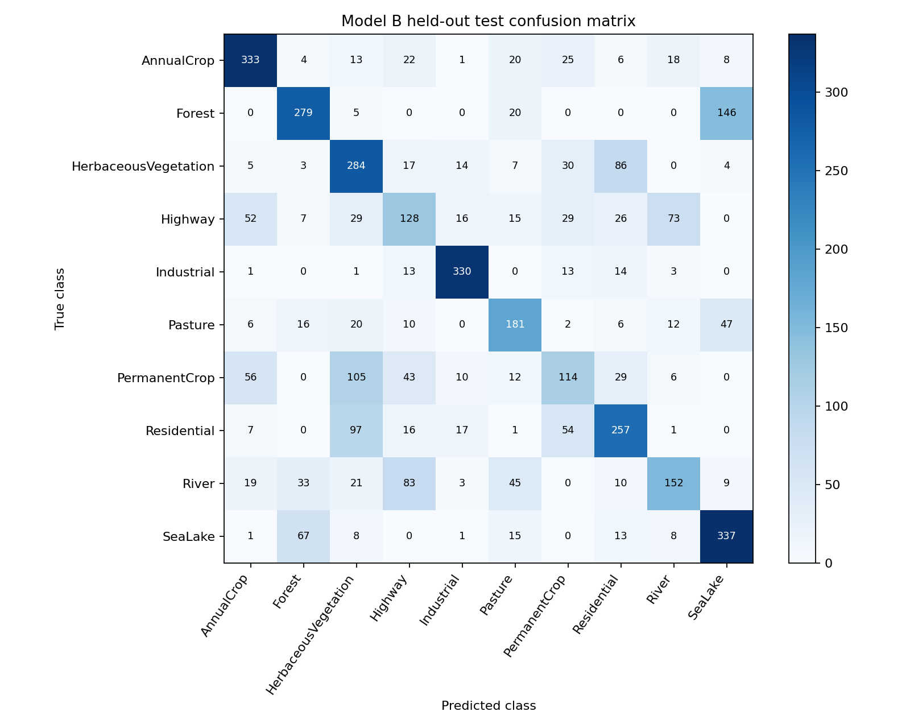
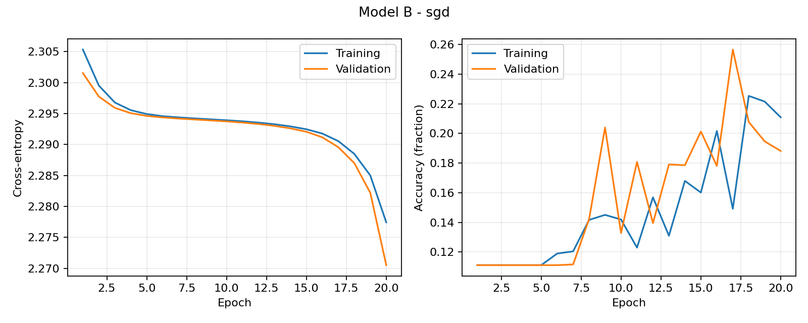
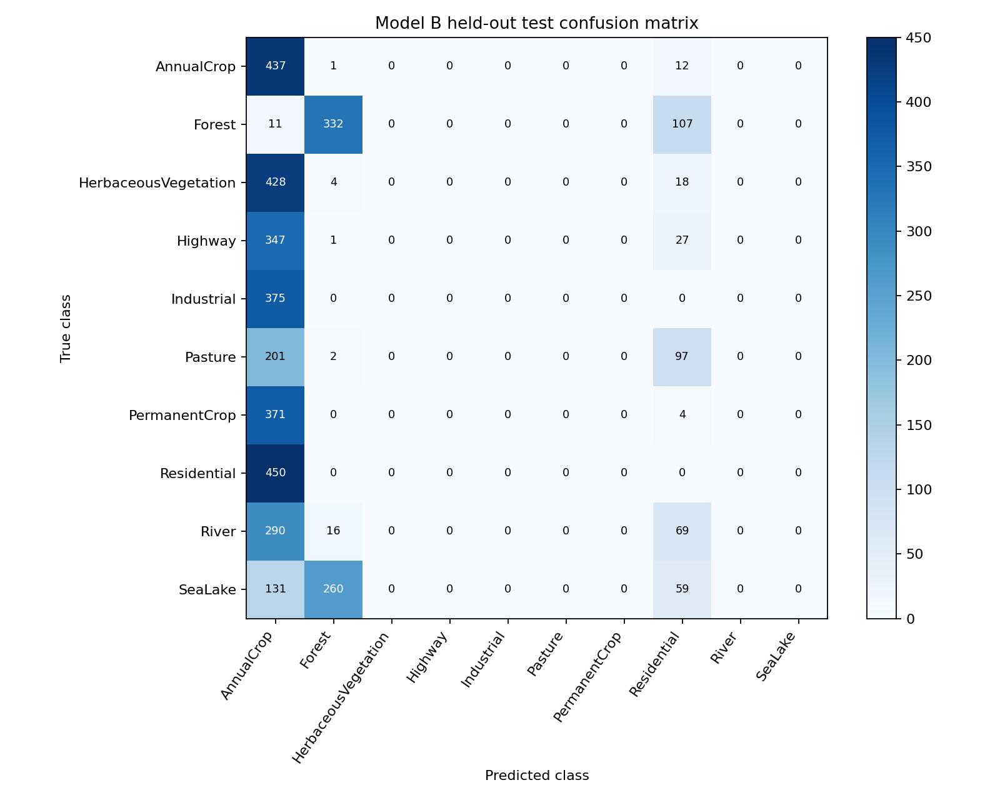
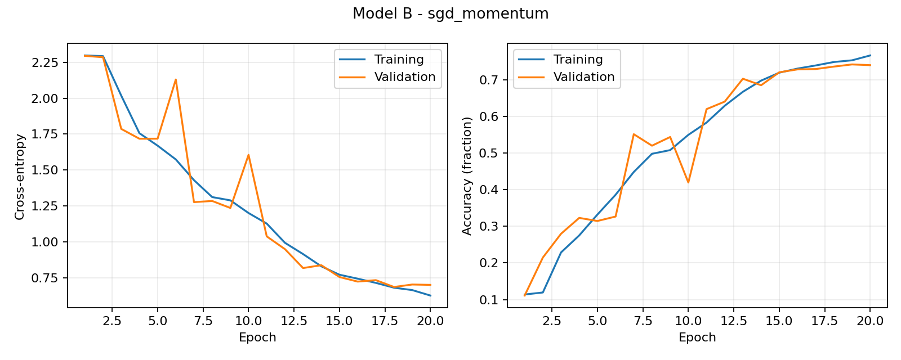
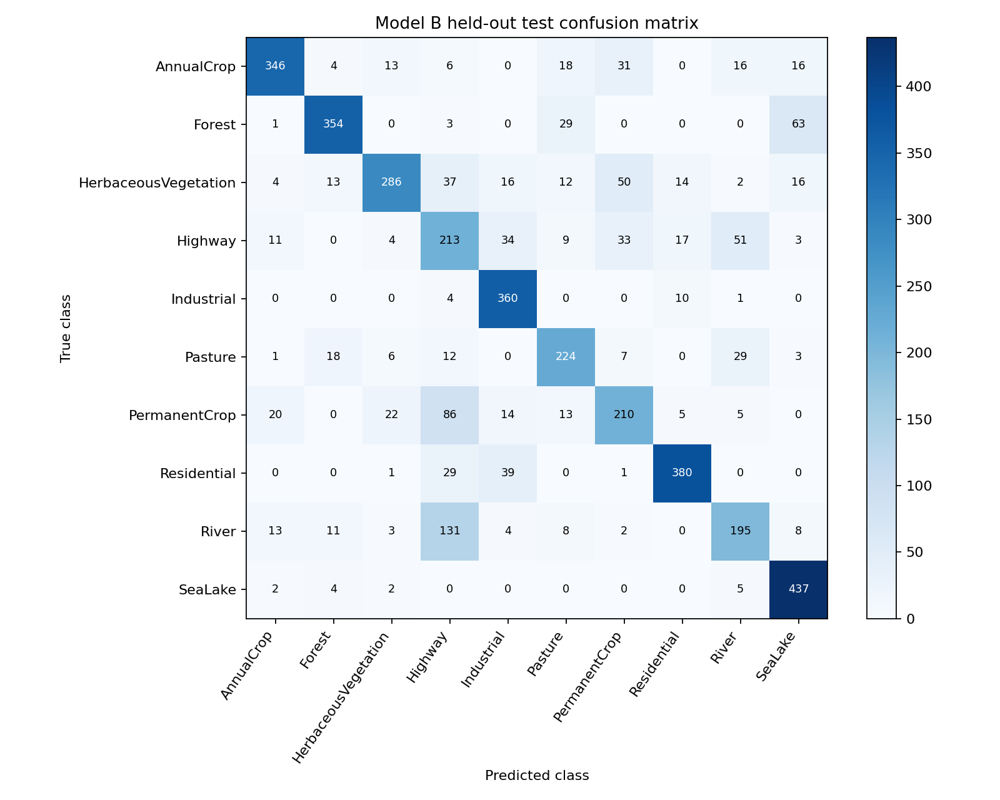

# Model B: EuroSAT experiment report

Generated from saved results; scores are fractions, times are seconds.

Dataset SHA-256: `548a976e7d3f714d69f2a93f1abaf6261494537faa33af10f762ad7614644dd1`. Seed: 42. Epochs per optimizer: 20. Batch size: 64.

Hardware/software: `{'platform': 'Linux-6.6.122+-x86_64-with-glibc2.39', 'processor': 'x86_64', 'python': '3.13.15', 'torch': '2.11.0+cu130', 'torchvision': '0.26.0+cu130', 'device': 'cuda', 'gpu': 'Tesla T4', 'cpu_threads': 1, 'git_commit': None, 'working_tree_dirty': None}`

## Controlled architecture comparison

Both custom models use widths 16/32/64, 2x2 max pooling after each convolution block, global average pooling, and a 64 -> 32 -> 10 ReLU head. Model B factorizes each standard convolution into a depthwise 3x3 and pointwise 1x1. No normalization, augmentation, schedule or weight decay is added.

| Model | Parameters | FP32 weights (KiB) | Conv/Linear MACs |
| --- | ---: | ---: | ---: |
| A | 25,994 | 101.54 | 11,209,024 |
| B | 5,589 | 21.83 | 1,579,328 |

Weight reduction: 78.50%; MAC reduction: 85.91%. Batch-one Conv2d and Linear only; one multiply-accumulate = one MAC (approximately two FLOPs). Bias adds, activations, pooling, memory traffic and framework overhead excluded. This is operation count, not latency.

## Model B optimizer comparison

The checkpoint with minimum validation cross-entropy is evaluated once on the test split. Optimizer comparisons use independently reset model and shuffle seeds. Adam is the predeclared primary optimizer (lr=0.001); plain SGD and SGD+momentum use lr=0.01, with momentum=0.9 for the latter. No optimizer is selected using test accuracy.

| Optimizer | Test accuracy | Macro precision | Macro recall | 95% Wilson CI | Mean epoch (s) | Best epoch |
| --- | ---: | ---: | ---: | --- | ---: | ---: |
| adam | 0.5914 | 0.5834 | 0.5845 | [0.5761, 0.6064] | 11.61 | 20 |
| sgd | 0.1899 | 0.0683 | 0.1709 | [0.1781, 0.2022] | 11.58 | 20 |
| sgd_momentum | 0.7420 | 0.7452 | 0.7361 | [0.7283, 0.7552] | 11.40 | 18 |

The Wilson interval describes image-level binomial uncertainty, not variability across seeds. Nearby satellite tiles may be correlated. This is one seeded run per optimizer, not a geographical holdout or evidence of statistical superiority.

## Curves and class errors

### adam

[Per-class scores](adam/per_class_metrics.csv) | [Detailed metrics](adam/test_metrics.json)

### sgd

[Per-class scores](sgd/per_class_metrics.csv) | [Detailed metrics](sgd/test_metrics.json)

### sgd_momentum

[Per-class scores](sgd_momentum/per_class_metrics.csv) | [Detailed metrics](sgd_momentum/test_metrics.json)

## Interpretation and limitations

Depthwise factorization restricts each input channel to one spatial filter before channel mixing. The resulting memory/operation saving can reduce representational capacity. ReLU uses a max-with-zero operation without exponentials. Global pooling avoids a large flattened head.

Momentum accumulates a smoothed gradient direction; compare the saved validation curves to plain SGD to assess convergence. Equal SGD learning rates isolate the addition of momentum; these fixed settings are not equally tuned optimizer optima.

Epoch times include synchronized training and validation, excluding checkpoint and plot writes. Do not compare Mac/Colab/Windows epoch times as architecture speedups. FP32 parameter storage excludes activations, runtime workspaces and optimizer state; actual state_dict and checkpoint bytes are recorded separately in test_metrics.json.

Run scripts/compare_model_b.py to combine these results with teammates' existing metrics without editing their files. See docs/model_b.md for parameter derivations and references.
